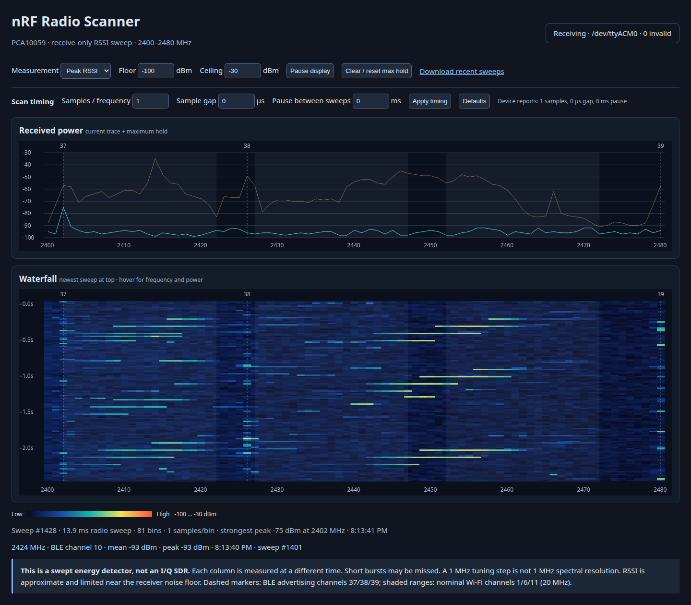

# nRF Radio Scanner — PCA10059 USB dongle

A receive-only 2.4 GHz **swept RSSI energy detector** with a local browser
waterfall. Detects energy without needing valid BLE packets. This is **not**
a HackRF-style I/Q SDR or a simultaneous full-band capture.

**Hardware verified (2026-10-30):** flashed through the existing USB DFU
bootloader and receiving real RSSI sweeps on a PCA10059. A continuous window of
600 sweeps had no sequence gaps and zero invalid frames: approximately **184 ms
per radio sweep / 5.26 sweeps per second** including USB delivery. The live
browser spectrum/waterfall, peak/mean selection, pause/resume and hover readout
were checked in Chrome with no JavaScript errors. These are live energy readings,
not simulated data or calibrated spectrum-analyzer measurements.



## See the waterfall

```sh
make setup
make run
```

Open **http://127.0.0.1:8765** on the same PC. The dongle must have the scanner
firmware installed (see below). The page has a live spectrum trace, maximum
hold, scrolling waterfall, peak/mean selection, adjustable color scale,
frequency inspection on hover, BLE advertising markers and Wi-Fi 1/6/11 guides.
There are no external web assets or CDN dependencies.

### Change scan timing live

The **Scan timing** inputs control the radio without reflashing:

| Input | Range | Default | Meaning |
|---|---:|---:|---|
| Samples / frequency | 1–64 | 16 | RSSI readings collected at each tuning point |
| Sample gap | 0–2000 µs | 128 µs | Extra delay after each RSSI reading |
| Pause between sweeps | 0–5000 ms | 0 ms | Minimum delay after a radio sweep before starting the next |

Click **Apply timing**. The service sends the request over USB serial; firmware
applies it at a sweep boundary. The page confirms the values reported by the
device, rather than assuming the request was applied. **Defaults** restores and
applies 16 samples, 128 µs gap, and no pause.

For faster scanning, try **4 samples / 16 µs gap / 0 ms pause**: on the tested
dongle this produced approximately **20 ms radio sweeps / 25 ms USB delivery
periods**. With a 100 ms pause, delivery was approximately 120 ms apart.
**1 sample / 0 µs gap / 0 ms pause** produced approximately 14 ms radio sweeps;
these timings are observations, not guaranteed rates. For longer
observation of each frequency, increase samples or gap. Reducing the dwell time
increases the chance of missing short bursts in one sweep. The displayed sweep
time is measured by the device and excludes the pause, JSON encoding, and USB
delivery; it is not a requested fixed sweep period. The actual start-to-start
period is at least sweep time + pause and may be longer due to USB transfer.

Settings live in RAM. The local service reapplies requested timing after a USB
reconnect while it remains running. Restarting the service does not itself reset
the dongle's active timing; power-cycling the dongle restores firmware defaults.

**Connection:** dongle → USB CDC serial → Python/pyserial → localhost HTTP/SSE →
browser. It does not use WebUSB or Web Serial. The server binds to localhost
only. Closing the browser does not stop recording; Ctrl+C in the server terminal
stops acquisition. The service reconnects automatically after unplug/replug.

`make run` records all sweeps in `captures/session.jsonl`. The page's download
link exports the most recent 600 sweeps. To choose a port explicitly:

```sh
.venv/bin/python scanner.py --port /dev/ttyACM0 --record captures/experiment.jsonl
```

## Hardware and measurements

- Nordic **PCA10059 nRF52840 dongle**, stock Nordic USB DFU bootloader.
- 81 tuning points: **2400 through 2480 MHz inclusive**, in 1 MHz steps.
- BLE 1 Mbit/s receiver mode, raw RSSI tasks; no BLE stack, packet requirement,
  transmissions, scan requests or automatic acknowledgements.
- By default, 16 RSSI measurements per point, with a 128 µs delay after each measurement.
  Receiver ramp-up and a 40 µs settling delay precede sampling each point.
- Reports arithmetic mean of dBm readings and strongest sampled RSSI per point.
  `sweep_us` measures the actual radio sweep duration, excluding USB transfer time.
- Green LED toggles per sweep. USB acquisition starts when the serial port opens.

Each point is observed at a **different time**, lowest frequency first. Short
bursts can be missed. The receiver filter limits frequency resolution; a 1 MHz
tuning step does not establish a calibrated 1 MHz resolution bandwidth.
Adjacent bins may respond to the same signal. RSSI near the noise floor is
limited and is not a calibrated spectrum-analyzer noise measurement.

BLE logical channel mapping:

| Channel | Center frequency |
|---|---|
| Advertising 37 | 2402 MHz |
| Data 0–10 | 2404–2424 MHz, 2 MHz steps |
| Advertising 38 | 2426 MHz |
| Data 11–36 | 2428–2478 MHz, 2 MHz steps |
| Advertising 39 | 2480 MHz |

## Build and flash on Linux x86-64

Prerequisites: Python **3.10+** with venv support, `make`, Git, curl, tar, and
access to the dongle's `/dev/ttyACM*` port. `make setup` downloads a pinned nRF5
SDK, xPack ARM GCC **10.3.1-2.3**, and Nordic **nrfutil 6.1.7** into `.deps/`;
Python dependencies go into `.venv/`. Nothing is installed system-wide.

```sh
make setup
make build
make flash
```

When prompted, press the dongle's **sideways RESET button**, not the large user
button. Its red LED should pulse, and USB DFU appears as **1915:521f**.
The flashing script waits up to 120 seconds for exactly one such device.

The package contains **only an application**, starting at **0x1000** and bounded
below **0xE0000**. MBR, bootloader, bootloader settings and UICR are not included.
The build validates every Intel HEX data record against that address range.
The existing application is overwritten; it is not backed up.
No external debug probe is needed. Outputs: `build/scanner.hex`, `build/scanner.zip`.

After installation, hold the large **user button for one second**, or send `b`
over the scanner serial port, to request the stock Nordic bootloader again.
The physical RESET button remains the fallback. Stop the acquisition service
before using the serial port with another tool.
The application uses the SDK's PCA10059 self-reset GPIO (P0.19, wired to RESET);
the stock Open DFU bootloader does not enable the GPREGRET entry method. The
serial `b` → USB DFU → application reflash path was verified on the real dongle.

### USB troubleshooting

If the red LED pulses but the bootloader does not appear as `1915:521f`, inspect
`journalctl -k` and the USB connection. During hardware bring-up, the original
hub connection produced USB descriptor timeouts (`-110`/`-71`), even in
bootloader mode. Unplugging the dongle and reconnecting directly to another PC
USB port restored bootloader enumeration. The revised application then flashed
and enumerated as **nRF Radio Scanner** on `/dev/ttyACM0`.

The page's **Scanner not found** state means the service is running but no
scanner USB serial interface is present. Passing `--port` cannot fix a missing
USB device. Once connected, acquisition resumes automatically; refresh the
page if needed. Only one process should own the serial port.

## Investigation procedure

1. Place the dongle near the BLE receiver that experiences trouble.
2. Record a baseline with nearby equipment operating normally.
3. Switch suspected devices off and on individually. Look for repeatable changes
   at the same frequencies; compare mean and peak views.
4. Move the dongle toward suspected sources and compare relative levels.
5. Check PC/USB noise too: move away from USB 3 equipment using a USB extension.

Broad energy across many bins is consistent with Wi-Fi; a stable narrow region
can indicate a spur. These shapes are clues, not unique source identification.

## Serial protocol

One JSON object per line:

```json
{"v":1,"seq":42,"start_us":12345,"sweep_us":190000,"first_mhz":2400,"step_mhz":1,"samples":16,"sample_interval_us":128,"pause_ms":0,"mean":[-95],"peak":[-60]}
```

The arrays above are abbreviated: actual frames contain **81 integer dBm values
in each array**. `start_us` is a wrapping 32-bit device uptime timestamp;
`seq` is a wrapping 32-bit sweep sequence. The host adds an independent `id`
and wall-clock `host_time` in seconds. Malformed frames are counted and rejected.

Timing command: `C <samples> <sample_interval_us> <pause_ms>\n`, for example
`C 4 16 100\n`. Out-of-range or malformed commands are ignored; the next sweep's
metadata confirms applied settings. Commands received during a sweep take effect
only on a later sweep. The local endpoint `POST /api/config` accepts the same
three named integer fields as JSON and queues the request for the serial reader.

## Checks

```sh
make check
make build
```

Checks include Ruff formatting/lint, protocol validation and real PTY → serial
reader → HTTP/SSE integration tests. Firmware builds with `-Wall -Werror`.
Tests do not require a dongle. Dependencies/build outputs/captures are gitignored.

Third-party license information: [THIRD_PARTY.md](THIRD_PARTY.md).

## Optional background service on this desktop

```sh
systemd-run --user --unit=nrf-radio-scanner \
  --working-directory="$PWD" \
  "$PWD/.venv/bin/python" scanner.py --record captures/session.jsonl
xdg-open http://127.0.0.1:8765
```

Stop with `systemctl --user stop nrf-radio-scanner`; inspect logs with
`journalctl --user -u nrf-radio-scanner`. This transient service does not start
automatically after reboot. To run it again after stopping, use `make run`.
